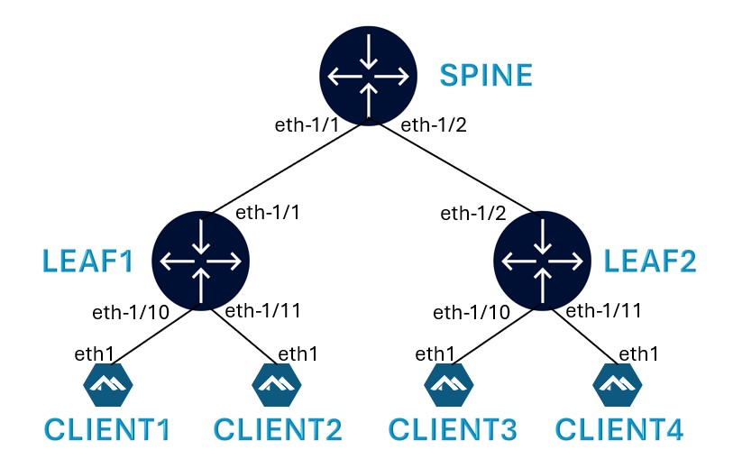

# Reference lab for Network for AI Security Blueprint

This is a reference lab providing a blueprint for securing Networks for AI as described in NANOG 98 talk - **A Blueprint for Securing Networks for AI : From Architecture to Operations**


## Lab Topology



### Lab Configuration

When the lab is deployed, a leaf-spine fabric is created with Layer2 and Layer3 EVPN configured to allow communication between the clients.

Client1 (192.168.10.50) and Client3 (192.168.10.60) are connected over a Layer2 EVPN.

Client2 (10.80.1.1) and Client4 (10.90.1.1) are connected over a Layer3 EVPN.

## Deploying the lab

Install Containerlab on your VM.

```bash
curl -sL https://containerlab.dev/setup | sudo -E bash -s "all"
```

**Logout and login for the sudo privileges to take effect.**

Clone this Git repo to your VM:

```
git clone https://github.com/srlinuxamericas/n98-ai-security.git
```

Verify that the git repo files are now available on your VM.

```
ls -lrt n98-ai-security/
```

To deploy the lab, run the following:

```
cd n98-ai-security
sudo clab deploy -t n98-ai-sec.clab.yml
```

[Containerlab](https://containerlab.dev/) will deploy the lab and display a table with the list of nodes and their IPs.

```bash

```

To display all deployed labs on your VM at any time, use:

```
sudo clab inspect --all
```

### Using Codespaces

This lab can be deployed using GitHub Codespaces. Once you are logged into GitHub, click the below icon and wait for 2 minutes for codespaces to be ready. During this initialization, codespace will install containerlab and gRPC clients so that you are all set to run the use cases immediately.

---
<div align=center>
<a href="https://codespaces.new/srlinuxamericas/n98-ai-security?quickstart=1">
</a>

**[Run](https://codespaces.new/srlinuxamericas/n98-ai-security?quickstart=1) this lab in GitHub Codespaces for free**.  
[Learn more](https://containerlab.dev/manual/codespaces/) about Containerlab for Codespaces.

</div>

---

## Connecting to the devices

Find the nodename or IP address of the device from the above output and then use SSH.

Username: `admin`

Password: `admin`

Note: Password less authentication is enabled by Containerlab using SSH keys.

```
ssh leaf1
```

To login to the client, identify the client hostname using the `sudo clab inspect --all` command above and then:

```bash
sudo docker exec -it client1 bash
```

